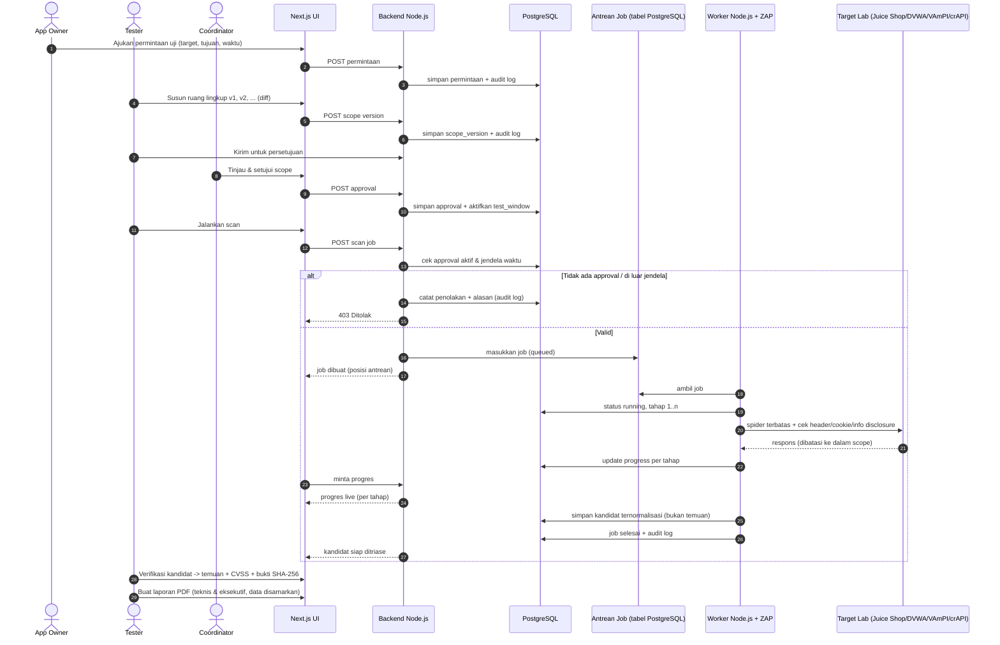
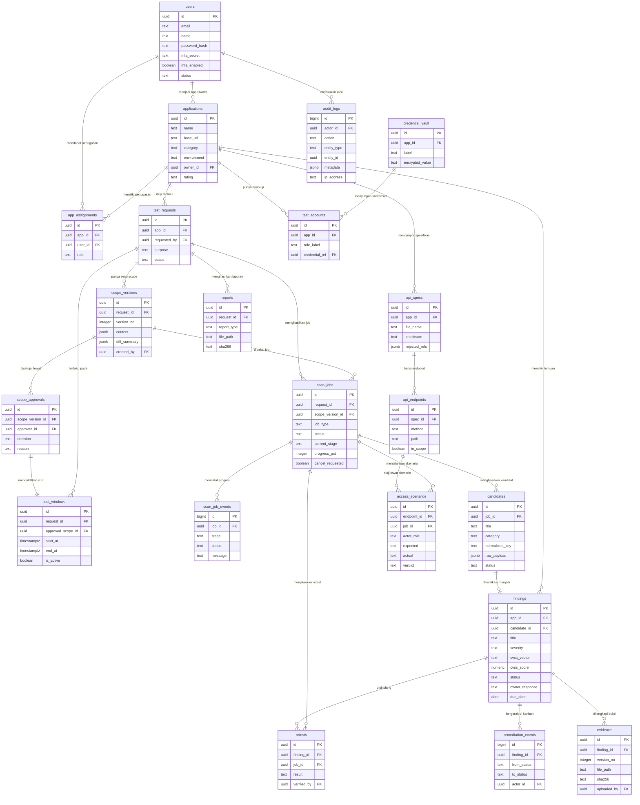

# PRD — Project Requirements Document

## 1. Overview

**Masalah yang diselesaikan**
Uji keamanan (VAPT) untuk aplikasi web dan REST API di lingkungan staging/lab UPA TIK ITERA saat ini dijalankan secara ad-hoc: izin pengujian sering hanya lewat obrolan, cakupan uji tidak terdokumentasi rapi, hasil scan tercecer, bukti temuan mudah tertimpa, dan laporan dibuat manual sehingga lambat. Akibatnya sulit membuktikan "siapa boleh menguji apa, kapan, dan hasilnya apa", serta sulit menuntaskan perbaikan temuan sampai benar-benar tertutup.

**Tujuan utama aplikasi**
Membangun **platform VAPT internal** yang membuat seluruh siklus uji keamanan menjadi rapi dan dapat diaudit dalam satu tempat:

> permintaan → ruang lingkup berversi → approval → scan → triage → remediasi → retest → laporan PDF

Yang ingin dicapai:
1. **Izin tes berjenjang** — tidak ada scan yang berjalan tanpa approval aktif dan jendela waktu yang sah.
2. **Scan otomatis terpantau** — scan web berjalan di antrean dan progresnya terlihat langsung per tahap.
3. **Temuan yang terbukti** — kandidat hasil scan tidak otomatis dianggap temuan; harus diverifikasi, diberi skor CVSS v4.0, dan dilengkapi bukti yang tidak bisa ditimpa.
4. **Perbaikan yang tuntas** — papan kanban remediasi, tanggapan pemilik aplikasi, retest, dan pengingat tenggat.
5. **Laporan siap bagikan** — PDF teknis dan eksekutif dengan data sensitif otomatis disamarkan.
6. **Kontrol akses ketat** — hak akses diatur per aplikasi dengan prinsip *deny by default*, dan semua aksi tercatat di jejak audit permanen.

**Pengguna utama:** developer dan tim keamanan (security) TIK ITERA, dengan peran Admin, Coordinator, Tester, dan App Owner.

**Kemenangan pertama pengguna:** setelah login, user langsung melihat **daftar tes keamanan** di dashboard lengkap dengan status, aplikasi, dan penanggung jawabnya.

---

## 2. Requirements

**Persyaratan fungsional inti**
1. **Alur uji berurutan dan tidak bisa dilewati**: permintaan → ruang lingkup berversi → persetujuan → scan → triage → remediasi → retest → laporan.
2. **Kontrol izin gerbang keras**: scan **ditolak** bila tidak ada scope yang disetujui/aktif **atau** waktu eksekusi berada di luar jendela waktu tes. Penolakan disertai alasan dan tercatat di audit log.
3. **Pemisahan tugas**: Tester tidak boleh menyetujui ruang lingkupnya sendiri; App Owner tidak boleh menjalankan scan atau menutup temuan.
4. **RBAC per aplikasi, deny by default**: akses hanya ada bila ada penugasan eksplisit antara user dan aplikasi.
   - **Admin**: kelola user, role, dan penugasan.
   - **Coordinator**: menunjuk tester dan menyetujui scope.
   - **Tester**: menyusun scope, menjalankan scan, verifikasi kandidat, memberi CVSS, retest, dan membuat laporan.
   - **App Owner**: mengajukan permintaan dan menanggapi temuan.
5. **Kandidat ≠ temuan**: hasil mentah scan disimpan sebagai kandidat; temuan resmi hanya terbentuk setelah diverifikasi user.
6. **Bukti tidak pernah ditimpa**: setiap unggahan bukti menjadi versi baru, disertai sidik digital **SHA-256** (tamper-evident).
7. **Penyamaran data sensitif**: token dan kata sandi selalu dimasking di log, tampilan, dan laporan PDF.
8. **Semua aksi diaudit**: pembuatan/perubahan data, approval, penolakan scan, eksekusi scan, verifikasi, perubahan status temuan, unduhan laporan, dan login tercatat permanen (append-only).
9. **Antrean pekerjaan & kontrol scan**: job bisa dihentikan dengan aman, progres tampil per tahap, dan pengaman anti-SSRF mencegah serangan ke luar target.
10. **Impor OpenAPI 3.x**: endpoint diinventaris, `$ref` ke luar cakupan otomatis ditolak; pengujian akses memakai akun uji per role dan skenario ekspektasi akses (BOLA/auth).
11. **Laporan PDF**: versi teknis (per temuan, bukti, cara perbaikan) dan versi eksekutif (ringkasan + rating A–F).

**Persyaratan non-fungsional**
- **UI/UX**: dark-first; monospace untuk data teknis; warna severity konsisten di semua halaman; **tanpa** gradien ungu dan tanpa emoji; wajib ada *empty state*, *loading state*, dan *error state* yang jelas.
- **Pola tampilan**: dashboard sebagai *command center* (daftar tes, sebaran severity, rating A–F, progress scan live) dan *workspace* dengan kategori **Web** dan **API**.
- **Keamanan data**: kredensial uji disimpan di vault terenkripsi dan hanya dipakai saat scan berjalan; tidak pernah tampil mentah.
- **Keterlacakan**: setiap job, kandidat, temuan, bukti, dan laporan punya satu identitas unik yang dapat ditelusuri sampai ke pemintanya.
- **Lingkungan uji**: target uji hanya lab/staging internal (Juice Shop, DVWA, VAmPI, crAPI) dalam Docker Compose.

**Di luar cakupan (tidak dikerjakan)**
SSO, notifikasi eksternal (email/chat), network scan, brute force, dan serangan DoS.

**Cara pengerjaan (task kecil berurutan)**
Fondasi → *vertical slice* dengan worker tiruan → subsistem A–D (Bintang: akun/RBAC/permintaan/scope/approval/antrean/audit; Rifael: worker web; Andika: API/OpenAPI; Ebentua: triage/temuan/CVSS/bukti/kanban/retest/laporan/dashboard) → hardening → evaluasi **precision/recall** di lab. Setiap task mencantumkan pemilik, dependensi, dan acceptance criteria yang teruji.

---

## 3. Core Features

### Fase 1 — Fondasi tampilan & gambaran menyeluruh
- **Dashboard Command Center** [high] — Halaman utama yang memperlihatkan seluruh daftar tes keamanan, kondisinya, dan skor keamanan tiap aplikasi dalam satu layar.
  - **Daftar Tes** — Semua tes keamanan tampil dalam satu daftar lengkap dengan status, aplikasi, dan penanggung jawabnya (ini juga menjadi *first win* user setelah login).
  - **Sebaran Severity** — Grafik jumlah temuan per tingkat keparahan supaya user langsung tahu mana yang paling mendesak.
  - **Rating A–F** — Setiap aplikasi diberi satu nilai huruf agar kondisi keamanannya mudah dibaca sekilas.
  - **Progress Scan Live** — Memantau tahap scan yang sedang berjalan secara langsung tanpa perlu menyegarkan halaman.
  - **Pencarian & Filter** — Menyaring daftar tes berdasarkan status, aplikasi, atau tingkat risiko yang dipilih.

### Fase 2 — Izin tes, scan web, dan uji akses API
- **Permintaan & Izin Tes** [high] — Alur pengajuan uji keamanan sampai izinnya disetujui, sehingga tidak ada tes yang berjalan tanpa persetujuan.
  - **Ajukan Permintaan** — Pemilik aplikasi mengajukan uji keamanan dengan mengisi target, tujuan, dan waktu yang diinginkan.
  - **Ruang Lingkup Berversi** — Cakupan uji disusun bertahap dan tiap perubahan bisa dibandingkan dengan versi sebelumnya (*diff*).
  - **Persetujuan Berjenjang** — Koordinator memeriksa dan menyetujui cakupan sebelum pekerjaan uji boleh dimulai; tester tidak dapat menyetujui scope miliknya sendiri.
  - **Jendela Waktu Tes** — Izin hanya berlaku pada rentang waktu tertentu; di luar itu scan otomatis ditolak.
- **Scan Otomatis Web** [high] — Menjalankan pemeriksaan keamanan otomatis pada aplikasi web dan memantau jalannya dari awal sampai selesai.
  - **Antrean Pekerjaan** — Scan yang diminta masuk antrean rapi dan user bisa melihat posisinya tanpa saling menunggu.
  - **Hentikan Scan** — Scan yang sedang berjalan bisa dihentikan kapan saja dengan aman bila sudah tidak diperlukan.
  - **Progress per Tahap** — Tiap tahap pemeriksaan—termasuk penjelajahan halaman secara terbatas—ditampilkan statusnya satu per satu.
  - **Cakupan Pemeriksaan** — Pemeriksaan menyasar header, cookie, dan informasi yang tidak sengaja terbuka, dengan pengaman agar tidak menyerang ke luar target (anti-SSRF).
  - **Kandidat Temuan** — Hasil mentah scan dikumpulkan sebagai kandidat dan belum dianggap temuan sampai diperiksa.
- **Uji Akses API** [medium] — Menguji apakah hak akses antar peran pada REST API sudah benar, misalnya apakah data pengguna lain bisa diakses.
  - **Impor OpenAPI** — Definisi API dari berkas OpenAPI 3.x dimuat untuk dipetakan, dan rujukan ke luar cakupan otomatis ditolak.
  - **Inventaris Endpoint** — Semua endpoint tampil lengkap dengan metode dan parameternya sebagai bahan pengujian.
  - **Akun Uji per Role** — Menyiapkan akun percobaan untuk tiap peran agar perilaku akses bisa dibandingkan.
  - **Skenario Ekspektasi Akses** — Menentukan siapa seharusnya boleh mengakses apa, lalu hasil nyatanya dibandingkan dengan harapan itu.

### Fase 3 — Temuan, perbaikan, dan pelaporan
- **Triage & Temuan** [high] — Memilah hasil scan menjadi temuan resmi yang terbukti, lengkap dengan tingkat bahaya dan bukti yang tidak bisa diubah.
  - **Verifikasi Kandidat** — User memutuskan kandidat mana yang benar-benar temuan dan mana yang hanya alarm palsu.
  - **Temuan Manual** — Temuan dari pengujian tangan dicatat dengan deskripsi, langkah, dan dampaknya.
  - **Skor CVSS** — Setiap temuan diberi nilai tingkat bahaya memakai standar CVSS v4.0.
  - **Bukti Berversi** — Bukti berupa tangkapan layar atau log disimpan berversi dengan sidik digital (SHA-256) sehingga tidak bisa ditimpa.
- **Papan Perbaikan** [high] — Tempat tim dan pemilik aplikasi mengikuti dan menuntaskan perbaikan temuan sampai terbukti aman lewat uji ulang.
  - **Papan Kanban** — Temuan digeser antar tahap perbaikan—baru, dikerjakan, menunggu uji ulang, selesai.
  - **Tanggapan Pemilik** — Pemilik aplikasi menanggapi temuan dan menuliskan rencana perbaikannya.
  - **Retest** — Temuan yang diklaim sudah diperbaiki diuji ulang untuk memastikan benar-benar tertutup.
  - **Pengingat Tenggat** — Temuan yang mendekati batas waktu perbaikan ditandai agar tidak terlupakan.
- **Laporan PDF** [high] — Mengubah hasil uji menjadi laporan siap bagikan, baik untuk tim teknis maupun untuk pimpinan.
  - **Laporan Teknis** — Laporan rinci per temuan berisi bukti dan cara perbaikannya untuk tim teknis.
  - **Laporan Eksekutif** — Ringkasan singkat berisi rating keamanan dan risiko utama untuk pimpinan.
  - **Penyamaran Data Sensitif** — Token dan kata sandi otomatis disamarkan sehingga tidak pernah ikut tercetak di laporan.

### Fase 4 — Akun, hak akses, dan jejak audit
- **Akun & Hak Akses** [medium] — Mengatur siapa boleh masuk dan boleh berbuat apa pada tiap aplikasi, plus catatan semua aksi yang terjadi.
  - **Masuk & MFA** — User masuk ke aplikasi dengan verifikasi dua langkah demi keamanan akun.
  - **Kelola Pengguna** — Admin menambah, menonaktifkan, dan mengatur akun pengguna.
  - **Peran & Penugasan** — Peran diatur per aplikasi; tanpa penugasan, seseorang tidak punya akses apa pun (deny by default).
  - **Vault Kredensial** — Kredensial untuk pengujian tersimpan aman dan hanya dipakai saat scan berjalan.
  - **Jejak Audit** — Semua aksi penting tercatat permanen dan tidak bisa diubah atau dihapus.

---

## 4. User Flow

**A. Alur utama satu siklus uji (happy path)**
1. **App Owner** login (dengan MFA) dan membuka dashboard → melihat daftar tes yang relevan dengan aplikasinya.
2. **App Owner** mengajukan permintaan uji: target (web/API), tujuan, dan waktu yang diinginkan.
3. **Tester** (yang ditunjuk **Coordinator**) menyusun ruang lingkup uji versi 1 (endpoint/halaman, akun uji, batasan), lalu memperbaruinya menjadi versi 2, 3, … Setiap perubahan bisa dibandingkan dengan versi sebelumnya.
4. **Tester** mengirim scope final untuk persetujuan.
5. **Coordinator** memeriksa scope, lalu **menyetujui** → sistem membuat **jendela waktu tes** yang aktif. (Tester tidak bisa menyetujui scope miliknya sendiri.)
6. **Tester** menjalankan scan: untuk Web memakai pemindaian otomatis; untuk API memakai impor OpenAPI + skenario ekspektasi akses.
   - Sistem memeriksa *approval aktif* dan *jendela waktu*. Jika gagal → scan **ditolak** dengan alasan yang tercatat.
   - Jika lolos → job masuk antrean; user melihat posisi antrean dan **progress per tahap** secara live, serta bisa menghentikan scan.
7. Hasil scan masuk sebagai **kandidat** (bukan temuan).
8. **Tester** melakukan **triage**: verifikasi kandidat → alarm palsu dibuang, kandidat valid menjadi **temuan** resmi; temuan manual bisa ditambahkan; setiap temuan diberi **skor CVSS v4.0** dan dilengkapi **bukti berversi + SHA-256**.
9. Temuan muncul di **papan kanban** → **App Owner** menanggapi dan menuliskan rencana perbaikan; tenggat ditandai bila mendekat.
10. Setelah memperbaiki, App Owner memindahkan temuan ke *menunggu uji ulang*; **Tester** melakukan **retest**. Jika terbukti aman → temuan ditutup; jika belum → kembali ke *dikerjakan*.
11. **Tester** membuat **laporan PDF** (teknis & eksekutif) dengan data sensitif tersamarkan, lalu membagikannya.
12. Rating A–F aplikasi dan sebaran severity di dashboard ikut diperbarui.

**B. Alur "kemenangan pertama" (cepat)**
Login → dashboard menampilkan **daftar tes** (status, aplikasi, penanggung jawab) → klik satu tes untuk masuk ke workspace-nya (kategori Web/API) → lihat detail, temuan, atau jalankan aksi sesuai peran.

**C. Alur gagal yang harus jelas ke user**
- Scan tanpa approval aktif → tombol scan nonaktif + pesan "Belum ada ruang lingkup yang disetujui".
- Scan di luar jendela waktu → ditolak + pesan rentang waktu yang berlaku.
- User tanpa penugasan aplikasi → halaman kosong terkontrol ("Anda belum punya akses ke aplikasi ini") dan tercatat di audit.
- Tester mencoba menyetujui scope sendiri → aksi diblokir dengan penjelasan pemisahan tugas.
- App Owner mencoba scan / menutup temuan → aksi diblokir.

---

## 5. Architecture

**Gambaran sistem**
- **Aplikasi Next.js (UI + backend Node.js)** — satu codebase berisi antarmuka (dashboard, workspace Web/API, kanban, laporan) sekaligus lapisan API/backend Node.js yang menegakkan RBAC, aturan approval + jendela waktu, dan penulisan audit log.
- **PostgreSQL** — sumber kebenaran tunggal: user & penugasan, permintaan, scope berversi, approval, job & progresnya, kandidat, temuan, bukti (metadata + hash), status remediasi, laporan, dan audit log.
- **Worker (proses Node.js terpisah)** — mengambil job dari **antrean berbasis tabel PostgreSQL**, menjalankan **OWASP ZAP** untuk pemeriksaan web (WSTG v4.2, spider terbatas, header/cookie/info disclosure, pengaman anti-SSRF), menjalankan uji akses API berbasis OpenAPI, menulis progres per tahap, dan menyimpan kandidat ternormalisasi.
- **Penyimpanan bukti** — berkas bukti (screenshot/log) disimpan pada volume Docker; sidik **SHA-256** dan versinya dicatat di PostgreSQL sehingga tidak bisa ditimpa.
- **Vault kredensial** — kredensial uji terenkripsi di database, hanya didekripsi di memori worker saat scan berjalan dan selalu dimasking pada log/laporan.
- **Docker Compose** — menjalankan aplikasi, worker, PostgreSQL, dan target lab (Juice Shop, DVWA, VAmPI, crAPI) dalam satu jaringan internal.

**Diagram alur scan (dengan gerbang izin)**

---

## 6. Database Schema

**Tabel & field utama**

**users** — akun pengguna platform
| Field | Tipe | Kegunaan |
|---|---|---|
| id | uuid (PK) | identitas user |
| name | text | nama tampilan |
| email | text (unik) | login |
| password_hash | text | kata sandi ter-hash |
| mfa_secret | text (nullable, terenkripsi) | kunci TOTP untuk MFA |
| mfa_enabled | boolean | status verifikasi dua langkah |
| status | text | aktif / nonaktif |
| created_at | timestamptz | waktu dibuat |

**applications** — aplikasi yang diuji (kategori Web/API)
| Field | Tipe | Kegunaan |
|---|---|---|
| id | uuid (PK) | identitas aplikasi |
| name | text | nama aplikasi |
| base_url | text | alamat target staging/lab |
| category | text | `web` atau `api` |
| environment | text | staging / lab |
| owner_id | uuid (FK users) | App Owner penanggung jawab |
| rating | text (nullable) | rating keamanan A–F (hasil hitung) |
| created_at | timestamptz | waktu dibuat |

**app_assignments** — penugasan peran per aplikasi (deny by default)
| Field | Tipe | Kegunaan |
|---|---|---|
| id | uuid (PK) | identitas penugasan |
| app_id | uuid (FK applications) | aplikasi terkait |
| user_id | uuid (FK users) | user yang diberi akses |
| role | text | `admin` / `coordinator` / `tester` / `app_owner` |
| assigned_by | uuid (FK users) | pemberi penugasan |
| created_at | timestamptz | waktu penugasan |

**test_requests** — permintaan uji keamanan
| Field | Tipe | Kegunaan |
|---|---|---|
| id | uuid (PK) | identitas permintaan |
| app_id | uuid (FK applications) | aplikasi yang diuji |
| requested_by | uuid (FK users) | App Owner pengaju |
| purpose | text | tujuan pengujian |
| target_url | text | target spesifik |
| desired_start / desired_end | timestamptz | waktu yang diinginkan |
| status | text | diajukan / disetujui / berjalan / selesai / ditolak |
| created_at | timestamptz | waktu pengajuan |

**scope_versions** — ruang lingkup berversi + diff
| Field | Tipe | Kegunaan |
|---|---|---|
| id | uuid (PK) | identitas versi scope |
| request_id | uuid (FK test_requests) | permintaan induk |
| version_no | integer | nomor versi (1,2,3,…) |
| content | jsonb | isi cakupan (endpoint, halaman, batasan uji) |
| diff_summary | jsonb | ringkasan perubahan vs versi sebelumnya |
| created_by | uuid (FK users) | penyusun (Tester) |
| created_at | timestamptz | waktu dibuat |

**scope_approvals** — persetujuan berjenjang
| Field | Tipe | Kegunaan |
|---|---|---|
| id | uuid (PK) | identitas approval |
| scope_version_id | uuid (FK scope_versions) | versi yang disetujui |
| approver_id | uuid (FK users) | Coordinator penyetuju |
| decision | text | `approved` / `rejected` |
| reason | text | alasan keputusan |
| decided_at | timestamptz | waktu keputusan |

**test_windows** — jendela waktu tes yang sah
| Field | Tipe | Kegunaan |
|---|---|---|
| id | uuid (PK) | identitas jendela |
| request_id | uuid (FK test_requests) | permintaan induk |
| approved_scope_id | uuid (FK scope_approvals) | dasar persetujuan |
| start_at / end_at | timestamptz | batas berlaku izin |
| is_active | boolean | status keaktifan izin |

**scan_jobs** — antrean & eksekusi scan
| Field | Tipe | Kegunaan |
|---|---|---|
| id | uuid (PK) | identitas job |
| request_id | uuid (FK test_requests) | permintaan induk |
| scope_version_id | uuid (FK scope_versions) | scope yang dipakai |
| job_type | text | `web_scan` / `api_access_test` / `retest` |
| status | text | queued / running / done / failed / cancelled |
| current_stage | text | tahap berjalan (spider, header, cookie, info disclosure, …) |
| progress_pct | integer | persentase progres |
| cancel_requested | boolean | penanda permintaan hentikan |
| created_by | uuid (FK users) | Tester pemicu |
| queued_at / started_at / finished_at | timestamptz | jejak waktu eksekusi |

**scan_job_events** — log progres per tahap (untuk progress live)
| Field | Tipe | Kegunaan |
|---|---|---|
| id | bigserial (PK) | urutan event |
| job_id | uuid (FK scan_jobs) | job terkait |
| stage | text | nama tahap |
| status | text | mulai / selesai / gagal |
| message | text (data disamarkan) | keterangan |
| created_at | timestamptz | waktu event |

**api_specs** — impor OpenAPI 3.x
| Field | Tipe | Kegunaan |
|---|---|---|
| id | uuid (PK) | identitas spesifikasi |
| app_id | uuid (FK applications) | aplikasi API |
| file_name | text | nama berkas sumber |
| checksum | text | SHA-256 berkas agar tidak berubah diam-diam |
| rejected_refs | jsonb | daftar `$ref` luar cakupan yang ditolak |
| imported_by | uuid (FK users) | pengimpor |
| created_at | timestamptz | waktu impor |

**api_endpoints** — inventaris endpoint
| Field | Tipe | Kegunaan |
|---|---|---|
| id | uuid (PK) | identitas endpoint |
| spec_id | uuid (FK api_specs) | spesifikasi asal |
| method | text | GET/POST/PUT/DELETE |
| path | text | jalur endpoint |
| params | jsonb | parameter/body |
| in_scope | boolean | lolos filter cakupan |

**test_accounts** — akun uji per role (kredensial di vault)
| Field | Tipe | Kegunaan |
|---|---|---|
| id | uuid (PK) | identitas akun uji |
| app_id | uuid (FK applications) | aplikasi terkait |
| role_label | text | nama peran uji |
| credential_ref | uuid (FK credential_vault) | rujukan kredensial terenkripsi |

**access_scenarios** — skenario ekspektasi akses (BOLA/auth)
| Field | Tipe | Kegunaan |
|---|---|---|
| id | uuid (PK) | identitas skenario |
| endpoint_id | uuid (FK api_endpoints) | endpoint diuji |
| actor_role | text | peran yang mencoba akses |
| expected | text | `allow` / `deny` |
| actual | text (nullable) | hasil nyata |
| verdict | text (nullable) | sesuai / menyimpang |
| job_id | uuid (FK scan_jobs) | job yang menjalankan |

**candidates** — hasil mentah scan (belum temuan)
| Field | Tipe | Kegunaan |
|---|---|---|
| id | uuid (PK) | identitas kandidat |
| job_id | uuid (FK scan_jobs) | job asal |
| endpoint_id | uuid (FK api_endpoints, nullable) | endpoint terkait (bila API) |
| title | text | ringkasan kandidat |
| category | text | header / cookie / info disclosure / akses API |
| normalized_key | text | kunci normalisasi untuk deduplikasi |
| raw_payload | jsonb (disamarkan) | bukti mentah |
| status | text | baru / terverifikasi_jadi_temuan / alarm_palsu |
| created_at | timestamptz | waktu dibuat |

**findings** — temuan resmi
| Field | Tipe | Kegunaan |
|---|---|---|
| id | uuid (PK) | identitas temuan |
| app_id | uuid (FK applications) | aplikasi terkait |
| candidate_id | uuid (FK candidates, nullable) | asal kandidat (null = temuan manual) |
| title / description / steps / impact | text | detail temuan |
| severity | text | critical/high/medium/low/info |
| cvss_vector | text | vector CVSS v4.0 |
| cvss_score | numeric | skor 0.0–10.0 |
| status | text | baru / dikerjakan / menunggu_retest / selesai |
| owner_response | text (nullable) | tanggapan & rencana perbaikan App Owner |
| due_date | date (nullable) | tenggat perbaikan |
| created_by | uuid (FK users) | Tester pembuat |
| created_at / updated_at | timestamptz | jejak waktu |

**evidence** — bukti berversi, append-only
| Field | Tipe | Kegunaan |
|---|---|---|
| id | uuid (PK) | identitas bukti |
| finding_id | uuid (FK findings) | temuan terkait |
| version_no | integer | versi bukti (tidak pernah ditimpa) |
| file_path | text | lokasi berkas di volume Docker |
| sha256 | text | sidik digital tamper-evident |
| mime_type | text | jenis berkas |
| uploaded_by | uuid (FK users) | pengunggah |
| created_at | timestamptz | waktu unggah |

**remediation_events** — pergerakan kanban & riwayat status
| Field | Tipe | Kegunaan |
|---|---|---|
| id | bigserial (PK) | urutan kejadian |
| finding_id | uuid (FK findings) | temuan terkait |
| from_status / to_status | text | perpindahan tahap |
| note | text (nullable) | catatan |
| actor_id | uuid (FK users) | pelaku |
| created_at | timestamptz | waktu |

**retests** — uji ulang temuan
| Field | Tipe | Kegunaan |
|---|---|---|
| id | uuid (PK) | identitas retest |
| finding_id | uuid (FK findings) | temuan yang diuji ulang |
| job_id | uuid (FK scan_jobs) | job retest |
| result | text | `tertutup` / `masih_terbuka` |
| verified_by | uuid (FK users) | Tester pemverifikasi |
| created_at | timestamptz | waktu retest |

**credential_vault** — kredensial uji terenkripsi
| Field | Tipe | Kegunaan |
|---|---|---|
| id | uuid (PK) | identitas kredensial |
| app_id | uuid (FK applications) | aplikasi terkait |
| label | text | nama/penanda |
| encrypted_value | text | nilai terenkripsi (masked saat ditampilkan) |
| created_by | uuid (FK users) | pembuat |

**reports** — laporan PDF
| Field | Tipe | Kegunaan |
|---|---|---|
| id | uuid (PK) | identitas laporan |
| request_id | uuid (FK test_requests) | permintaan induk |
| app_id | uuid (FK applications) | aplikasi terkait |
| report_type | text | `technical` / `executive` |
| file_path | text | lokasi PDF |
| sha256 | text | sidik digital laporan |
| generated_by | uuid (FK users) | pembuat |
| created_at | timestamptz | waktu dibuat |

**audit_logs** — jejak audit permanen (append-only)
| Field | Tipe | Kegunaan |
|---|---|---|
| id | bigserial (PK) | urutan kejadian |
| actor_id | uuid (FK users, nullable) | pelaku |
| action | text | mis. `scan.rejected`, `scope.approved`, `finding.closed` |
| entity_type / entity_id | text / uuid | objek yang terdampak |
| metadata | jsonb (disamarkan) | konteks tambahan, token/password dimasking |
| ip_address | text | asal permintaan |
| created_at | timestamptz | waktu kejadian |

**Diagram relasi antar tabel**

---

## 7. Tech Stack

**Fondasi proyek: template "Starter Next JS" v0.1.0 (NgodingPakeAI)**
Proyek ini dibangun di atas codebase siap pakai **Starter Next JS v0.1.0**. Setup awal — kerangka framework, koneksi database, autentikasi dasar, dan konfigurasi deployment — **sudah tersedia**, sehingga implementasi langsung berfokus menambah fitur VAPT di atasnya (bukan menyiapkan ulang fondasi).

**Stack yang dipakai (dikunci, tidak diganti)**
- **Frontend:** Next.js + TypeScript, Tailwind CSS, shadcn/ui — dipakai untuk dashboard *command center*, workspace Web/API, papan kanban, dan tampilan laporan. Gaya visual: dark-first, monospace untuk data teknis, warna severity konsisten, tanpa gradien ungu/emoji, dengan *empty/loading/error state*.
- **Backend:** Node.js (API & logika bisnis dalam proyek Next.js) — menegakkan RBAC per aplikasi, gerbang approval + jendela waktu, masking data sensitif, dan penulisan audit log. Proses **worker** Node.js terpisah mengambil job dari antrean (tabel PostgreSQL) untuk menjalankan pemindaian web (OWASP ZAP, WSTG v4.2) dan pengujian akses API.
- **Database:** PostgreSQL — menyimpan seluruh data transaksi (permintaan, scope berversi, approval, job & progres, kandidat, temuan, bukti + hash SHA-256, audit log, laporan) sekaligus menjadi antrean job. Berkas bukti dan PDF disimpan pada **volume Docker** dengan hash tercatat di database.
- **Deployment:** Docker + Docker Compose — satu perintah untuk menjalankan aplikasi, worker, PostgreSQL, dan target lab (**Juice Shop, DVWA, VAmPI, crAPI**) dalam jaringan internal yang terisolasi.

**Catatan konsistensi stack**
Karena stack template bersifat mengikat, tidak ada layanan tambahan di luar empat komponen di atas; antrean pekerjaan, penyimpanan bukti, dan penjadwalan retest/pengingat tenggat dijalankan memakai Node.js worker + PostgreSQL + volume Docker. Semua fitur pada Fase 1–4 dibangun sebagai penambahan modul di atas fondasi template, tanpa mengganti framework, database, maupun mekanisme deployment.